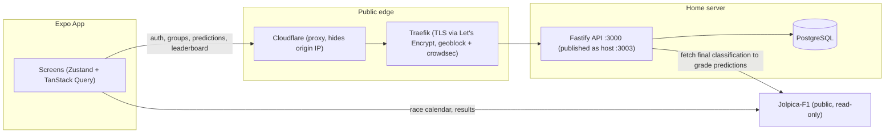

# Architecture

## Decisions

| Area              | Decision                                                                                                                       | Why                                                                                                                                                                                                                              |
| ----------------- | ------------------------------------------------------------------------------------------------------------------------------ | -------------------------------------------------------------------------------------------------------------------------------------------------------------------------------------------------------------------------------- |
| Monorepo          | pnpm workspaces: `apps/mobile`, `apps/api`, `packages/shared`                                                                  | One repo (Moodle takes a single URL); `packages/shared` holds Zod schemas both apps import, instead of an RPC framework                                                                                                          |
| Mobile            | Expo (managed), Zustand, TanStack Query, NativeWind                                                                            | Both of us already know React/TS; Expo covers the required native feature (notifications) with no custom native code                                                                                                             |
| Backend framework | Fastify, not Hono                                                                                                              | Hono's RPC client has an open bundler-resolution issue with Expo/Metro in a monorepo; Fastify has a bigger ecosystem for two people newer to backend work                                                                        |
| ORM / DB          | Drizzle + PostgreSQL                                                                                                           | Typed schema, SQL-first, migrate-on-startup fits a single always-on shared instance                                                                                                                                              |
| Validation        | Zod, at the route layer, before business logic                                                                                 | Bad input rejected early with a clear error, not a stack trace three layers down                                                                                                                                                 |
| Two data sources  | Jolpica-F1 (public, read-only, called directly from the app) vs. our own API (predictions/groups/leaderboard, source of truth) | Keeps scoring un-gameable — grading happens server-side against Jolpica-F1, not trusted from a client                                                                                                                            |
| Hosting           | Self-hosted on Ricky's home server via Coolify, fronted by an existing (non-Coolify-managed) Traefik instance                  | Matches the team's proven TourPlanner deployment pattern                                                                                                                                                                         |
| Public hostname   | `lightsout-api.w11core.cc` — one subdomain level, not `api.lightsout.w11core.cc`                                               | Cloudflare's free Universal SSL only covers one level; two-level hosts need the paid Advanced Certificate Manager add-on to be proxied. One level dodges that, for free, and still hides the origin IP behind Cloudflare's proxy |

## Request flow

The app talks to Jolpica-F1 directly for read-only race data, and to our own API for everything that needs to be trusted or shared (auth, predictions, grading, leaderboard). The API is the only thing that ever grades a prediction — it fetches the real result itself, so a client can't submit its own score.

## Deployment shape

Single Coolify "Docker Compose" resource (`docker-compose.prod.yml`), two services:

- `api` — built from `apps/api/Dockerfile`, runs migrations on startup, publishes host port `3003` (declared directly in the compose file — Coolify's Docker Compose resource type has no separate UI field for this)
- `db` — `postgres:18-alpine`, internal-only, no host port

Coolify's own proxy is not involved in routing (the "Domains" field on the resource is left empty on purpose — filling it in makes Coolify auto-generate a conflicting Traefik router from Docker labels). Routing is handled entirely by a hand-written dynamic Traefik config on the home server, outside this repo.
