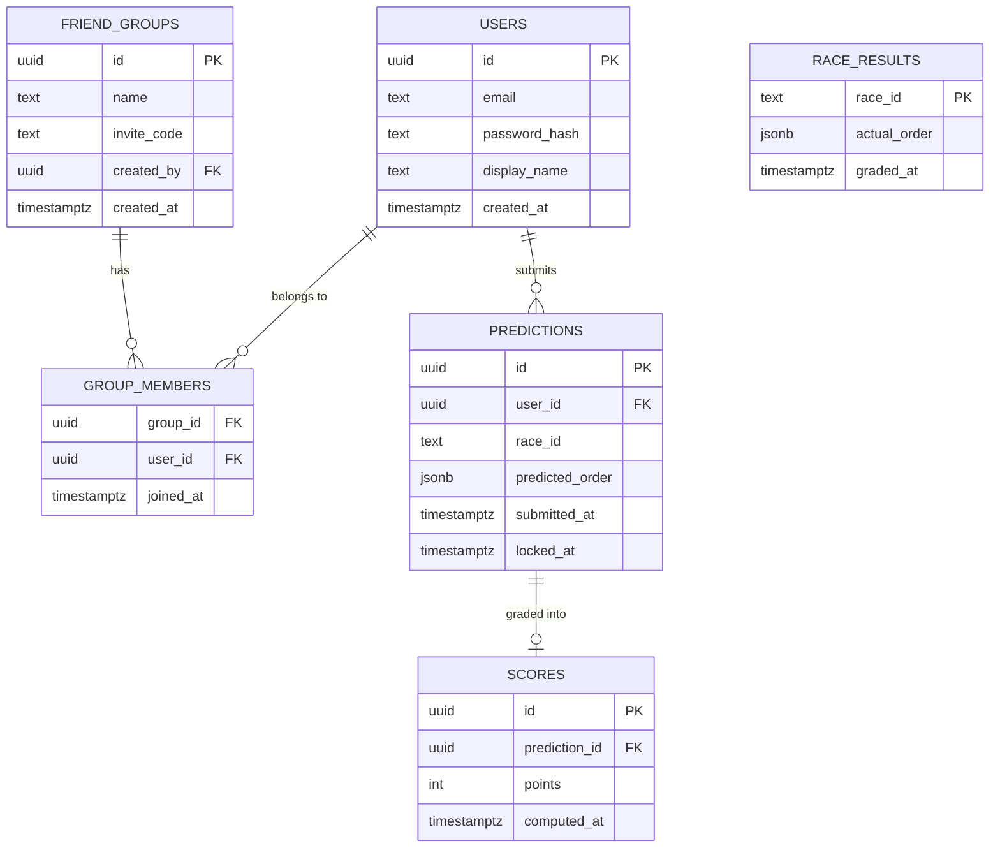

# Data model

## Current

Only `health_check` exists so far (LO-3, disposable — proves the migration pipeline runs, not a real domain table).

## Planned (LO-4 through LO-7)

Predictions are scoped to a user and a race, not to a group — a user predicts once per race, and that same prediction/score counts toward every friend group they're a member of. This avoids duplicating a prediction row per group.

Notes:

- `race_id` is the identifier from Jolpica-F1 (season + round), not a foreign key to a table we own — we don't mirror their race calendar, just cache the final classification once a race is graded (`race_results`).
- `predicted_order` / `actual_order` are JSON arrays of driver codes, ordered — simplest fit for "top 5, in order" without a join table per position.
- A prediction has at most one `scores` row, created once `race_results` exists for that `race_id` and the grading job runs (LO-6).
- The leaderboard (LO-7) is a query, not a table: sum `scores.points` for predictions belonging to users in a given group.
- `invite_code` on `friend_groups` is what LO-4's join flow checks against — no separate invites table needed for this scale.

This is a plan, not a lock-in — expect it to shift a little once LO-4 is actually being implemented.
