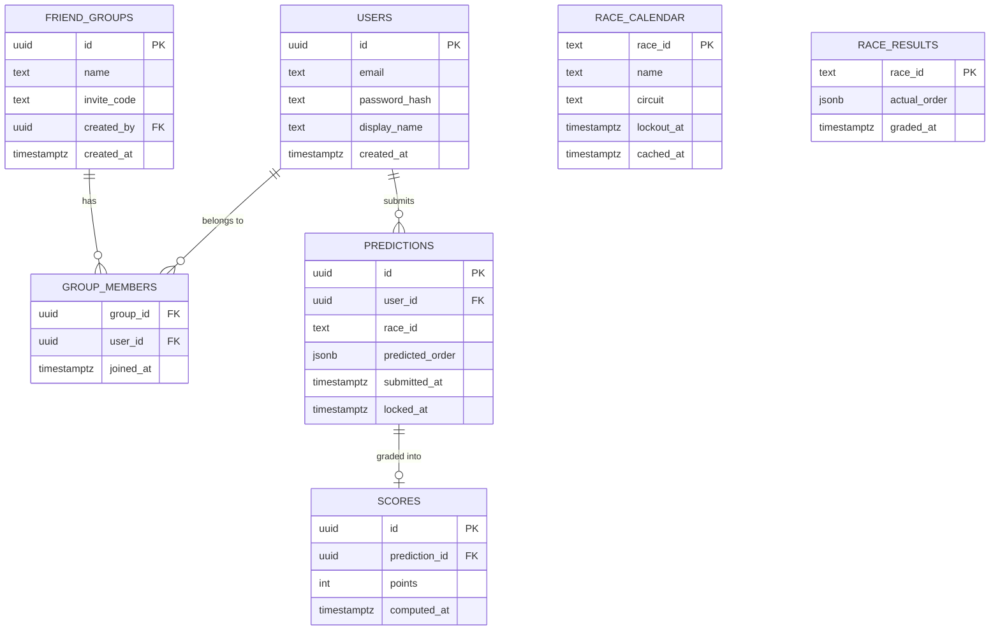

# Data model

## Current

`health_check` (LO-3, disposable, proves the migration pipeline runs, not a real domain table).

`users`, `friend_groups`, and `group_members` (LO-4) are live, matching the plan below. Auth is a self-issued JWT pair: a short-lived access token and a longer-lived refresh token, both stateless, no server-side session or refresh-token table. `POST /auth/refresh` just re-verifies the refresh token's signature and expiry and mints a new pair, so there's no revocation before a refresh token's own expiry. `GET /groups` (LO-19) lists the current user's groups, since a group's id and invite code are otherwise only ever returned once, from the create/join response.

`race_calendar` and `predictions` (LO-5, with a minimal LO-18 pulled forward since LO-5's lockout check needs a real lockout timestamp to compare against) are also live. `race_calendar` is refreshed from Jolpica-F1's current-season schedule whenever the most recently cached row is older than `RACE_CALENDAR_CACHE_TTL_HOURS` (default 24h). `race_id` is `{season}-{round}` (e.g. `2026-15`). A prediction's `locked_at` is a snapshot of the race's `lockout_at` taken at submission time, not a live join, so a later calendar correction can't retroactively lock or unlock an already-submitted prediction. Sealing (`GET /groups/:groupId/races/:raceId/predictions`) compares the current time against the race's live `lockout_at` from `race_calendar`, not the per-user snapshot, since members who haven't submitted yet have no snapshot to compare against, and deliberately nulls out everyone's `predictedOrder` pre-lockout, including the submitter's own. `GET /predictions/:raceId` (LO-20) is the one place a user can always see their own full prediction, locked or not.

`race_results` and `scores` (LO-6) are also live. A background job on the API process checks every `GRADING_INTERVAL_MINUTES` (default 30) for races past their `lockout_at` with no `race_results` row yet, fetches the final classification from Jolpica-F1, and scores every prediction for that race. A race with no `race_results` row yet is skipped and retried on the next tick, covering the gap between a session ending and Jolpica-F1 publishing its official classification. Scoring is per predicted position: 5 points for the exact driver in the exact position, 2 points if that driver finished somewhere else in the actual top 5, 0 if they didn't finish in the top 5 at all. Both the `race_results` insert and the `scores` insert use `ON CONFLICT DO NOTHING` on top of an already-graded check, so a race can't be scored twice even if the job overlaps itself.

`GET /users/me` (LO-22) returns the current user's id/email/displayName, since the JWT only carries a user id and no other endpoint ever returns those fields outside the one-time register/login response. `GET /users/me/history` (LO-21) returns every prediction the user has ever submitted, newest first, each merged with its `race_results.actual_order` and `scores.points` when graded, or `null` for both when the race hasn't been graded yet, composed in the service layer from three separate repository calls rather than one cross-table SQL join, matching how the leaderboard composes across `groups`/`scores`.

## Full domain model

Predictions are scoped to a user and a race, not to a group. A user predicts once per race, and that same prediction and score counts toward every friend group they're a member of. This avoids duplicating a prediction row per group.

Notes:

- `race_id` is the identifier from Jolpica-F1 (season plus round, e.g. `2026-15`), not a foreign key to a table we own. `race_calendar` and `race_results` are both caches keyed by that same external identifier, refreshed on a staleness check rather than mirrored as a full relational copy.
- `predicted_order` and `actual_order` are JSON arrays of driver codes, in order. Simplest fit for "top 5, in order" without a join table per position.
- A prediction has at most one `scores` row, created once `race_results` exists for that `race_id` and the grading job runs.
- The leaderboard (LO-7) is a query, not a table: `GET /groups/:groupId/leaderboard` sums `scores.points` per member of the group and sorts descending. Members with no graded predictions yet still appear, at zero points.
- `invite_code` on `friend_groups` is what LO-4's join flow checks against. No separate invites table needed for this scale.
